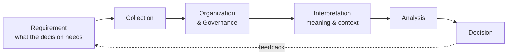

## Eric Guadanini

> **Data Governance Lead · Organizational Intelligence · Data, AI & Knowledge Management**

Data without strategic context is just noise. My work covers the whole path information takes inside an organization: how it is collected, organized, governed, given meaning, analyzed and, finally, turned into a decision.

I come from intelligence and strategy (M.A. in International Relations) and data science (FIAP). Today I lead data governance end to end: I design the governance and build the infrastructure that runs it.

---

### 🧭 Organizational Intelligence: one function, four disciplines

Organizations rarely fail for lack of data. They fail at the seams: between teams, between a dataset and what it actually means, between information and the decision it was supposed to inform. I treat four disciplines as parts of a single function.

| Discipline | Question it answers | Where it sits in the chain |
|---|---|---|
| **Intelligence** | What does the decision-maker need to know, and what are we missing? | Requirements and analysis |
| **Data Governance** | Can this data be trusted, and who answers for it? | Collection, organization and quality |
| **Knowledge Management** | What does it mean, and how does tacit knowledge get written down? | Interpretation and shared context |
| **AI** | Who, or what, consumes it and acts on it? | Analysis and use, at scale |

---

### 🏛️ What I do

* **Governance program:** designed the proposal, secured management approval and lead the rollout on OpenMetadata, with metadata, lineage, business glossary and data quality tests in production.
* **Quality signals for leadership:** specified a weekly data quality report prioritized by criticality, with baseline coverage for every table (volume, variation, schema changes) and full statistical profiling for the tables that feed data products.
* **Incident response:** after failures in production tables, defined with management, analytics and IT a three-front plan that I lead: lineage of data products, an anomaly report with history, and verification gates that flag structural changes and call the accountable owner.
* **Observability & AI:** built an AI agent for data quality and an API-based dashboard monitoring bot; set up pipeline failure (Airflow) and schema change alerts; designed database monitoring from a framework organized by data layers.
* **Accountability:** rolling out data owners and data stewards by schema and platform.
* **Cross-team coordination:** created an analytics–IT group to manage structural changes in the databases; with infrastructure, scoped and designed the integration of quality indicators into their monitoring platform.
* **Knowledge management:** assessed reference frameworks (DAMA-DMBOK, TOGAF, BPMN, SIPOC) against the organization's processes and wrote CRISP-DM and Spec-Driven Development guides for the internal knowledge base.
* **Platform evaluation:** ran a comparative assessment of OpenMetadata and Dataedo, supervising an intern throughout.

---

### 🔭 Where I'm heading

* From implementation toward strategy: designing how an organization knows what it knows.
* Extending data governance into **AI governance**.
* Studying **ontologies and knowledge graphs** as the semantic layer between governed data and AI.
* Postgraduate program in **Tech Management** at FIAP (2026–2027).

---

### 📂 Featured project

**[Brazil's Semiconductor Supply Chain Vulnerability](https://github.com/ericguadanini/brazil-semiconductor-risk-data-analysis)**
A strategic intelligence analysis of 2025 Comex Stat trade data: over 92% of Brazil's semiconductor imports come from Asia, exposing national industry to conflict in the Taiwan Strait and the South China Sea. Ends with risk recommendations for decision-makers. *Python, Pandas, Seaborn.*

---

### 🛠 Toolkit

**Governance & data platforms**

**Data & analysis**

**BI, automation & workflow**

---

### 🎓 Background

M.A. in International Relations, PUC Minas (2025), with a thesis on Sino-American competition over Taiwan through offensive realism · B.A. in International Relations, Ibmec (2022) · Technologist in Data Science, FIAP (2026)

  
  

